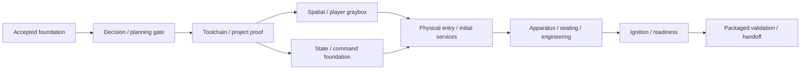

# Awakening The Outlaw Star — Vertical Slice 1 Implementation Plan

| Field | Value |
| --- | --- |
| Created / last edited | 2026-10-07 / 2026-10-25 |
| Status | Phases 1 and 2 and subphase 3.1 complete; 3.2A unstarted |
| Prepared by | Codex, from approved Reconstruction / Implementation Baseline v1 |
| Maintainer | Repository owner |
| Planning baseline | Baseline v1 published in `d05d1822a41b3e0a3b03bd015676d97124a08fab` |
| Current checkpoint | Phase 3.1 accepted and closed 2026-10-24, including published asset recovery; stop before 3.2A |

## Purpose And Placement

Deliver the first playable **Awakening the Outlaw Star** slice: approach the supported dormant ship,
enter it, traverse the required interior, initialize services, deploy the navigation apparatus,
prepare engineering, return to the bridge and complete ignition to **SHIP READY**. Keep the ship
supported in the hangar; do not launch. Startup success does not end play: allow seat exit, continued
exploration and hatch exit/re-entry across the active-ship/low-gravity-hangar boundary.

This is the execution checklist and phase-status owner. Baseline v1 owns spatial/motion constraints,
operational vocabulary and slice scope/acceptance. Architecture documents own shared-state and
interaction requirements; source reviews own evidence. This plan cannot silently change those contracts.
Its format follows the user-supplied implementation plans: accepted foundations, decimal subphases,
explicit prerequisites, reviewable checklists, validation, recovery and phase exit gates. No unrelated
project facts, deployment policies or framework lifecycles are imported from the format references.

## Current State And Next Action

Reference/research is substantially complete for defining this bounded slice. Baseline v1 is approved
and published. The Blank C++ OutlawStarSim skeleton has been generated at its accepted location;
the neutral map is saved and selected for editor/game startup. No ship graybox, slice gameplay or machinery rig exists.
Neutral build/editor/Play input, repeated launch and fresh-checkout editor checks passed in 2.3;
the selected Unreal MCP pilot also completed. Neutral standalone packaging and repeated input/exit
passed in 2.4; slice gameplay and performance acceptance remain untested.

The October 7, 2026 planning authorization superseded the earlier hold on
**introducing the planning gate**. Its scope covered this document and navigation/status updates only.
The user confirmed this plan and its MCP additions for publication on 2026-10-07.
The user initially authorized Phase 1.1 only; its read-only inventory and host/target decisions are
complete in the [dated readiness record](phase-1-1-host-tooling-readiness.md). Subsequent Phase 1.2/1.3
planning is also complete; Phase 1.4 closeout and Phase 1.5 gate review are accepted. The read-only
2.1 preflight and follow-up verified the scoped repository-owner installations. Phase 2.1 closeout
was accepted on 2026-10-23. Phase 2.2 skeleton/repository work is explicitly authorized, with guided
Unreal setup. Subsequent explicit authorization covered 2.3 and its optional Unreal MCP pilot;
the [2.3 closeout](phase-2-3-closeout.md) is accepted. No 2.4 work is authorized.
Phase 1.2 began with the opening experience
and additional targeted references. Its [decision packet](phase-1-2-spatial-motion-decision-packet.md)
and [closeout package](phase-1-2-closeout-proposal.md) are now accepted for planning. No later
subphase starts automatically. Phase 1's exit review still precedes project creation.

The [Phase 1.2 reservation audit](phase-1-2-reservation-audit.md) records remaining mechanism/access
constraints against the accepted general layout. It is planning evidence, not a modeled fit pass or
subphase completion; use its ledger for later MC validation and bounded layout iteration.

Do not begin Unreal initialization, modeling, installations or implementation because this file exists
or because its documentation commit is confirmed. Once a concrete subphase is authorized, complete
routine implementation, fixes and relevant validation within that scope without adding permission
pauses for every file or test. Publication still follows the user's explicit confirmation workflow.

## Authoritative Inputs

- [Spatial constraint map](../reconstruction/baseline-v1/spatial-constraint-map.md): S01–S16, H01–H06,
  accepted 72 × 21 × 16 m overall envelope, unknown connections and E/D boundaries.
- [Motion/clearance envelopes](../reconstruction/baseline-v1/motion-clearance-envelopes.md): M01–M13
  reservations and MC-01–MC-08 interference checks.
- [Operational state baseline](../reconstruction/baseline-v1/operational-state-baseline.md): commissioning
  versus departure/transit/recovery; shared component state rather than one invented power ladder.
- [Slice contract](../reconstruction/baseline-v1/vertical-slice-1.md): inclusions, exclusions, eight
  readiness conditions, VS-01–VS-10 acceptance and VS-D01–VS-D07 unresolved decisions.
- [Canon policy](../canon-policy.md), [vision](../vision.md) and [design pillars](../design-pillars.md).
- [Unreal/toolchain strategy](../architecture/unreal-strategy.md), [player/camera/control](../architecture/player-camera-control.md),
  [interaction](../architecture/interaction-system.md), [simulation](../architecture/ship-simulation.md)
  and [external-control compatibility](../architecture/external-control-automation.md).
- [Ongoing research](../reconstruction/open-questions.md) and [reference index](../reconstruction/xgp-reference-index.md).
  Research resolves specific constraints; it does not add feature scope without agreement.
- [Editor automation evaluation](../architecture/editor-automation.md): Blender/Unreal MCP candidates,
  adoption requirements, bounded pilots and fallbacks; optional development tooling, not runtime scope.

## Scope And Operating Rules

- Deliver one physical player with first/third-person perspective over the same body/state; camera
  perspective does not grant equipment access or change command permissions.
- Include minimal hangar/hull context, one selected entry, bridge/passage/engineering route, initial
  services, placeholder-occupied apparatus, seat-cluster lift, all four engineering endpoints,
  cockpit key ignition and deterministic status/guidance.
- Keep detailed art, full rooms/crew, flight, sub-ether, combat, weapons, damage/repair models,
  calibrated power physics, Gilliam LLM and external adapters outside this slice.
- Reserve future mechanisms spatially. Reservation is not implementation of grapplers, robots,
  Shooter, lounge furniture or landing/sub-ether behavior.
- Keep C++ authoritative state/validation independent of presentation. Blueprints configure and
  compose assets, motion and feedback; they do not own a competing readiness system.
- A control submits a request; acceptance, progress and completion are distinct. All required local
  actions remain local. Guidance cannot bypass the player route by silently completing them.
- Record geometry E, gameplay F and strong inference D explicitly; none becomes canon. Selected
  B-candidate drawings do not gain authenticated provenance through implementation.
- Use small reviewable increments. Subphase numbers do not prescribe commit counts. Preserve user
  edits and unrelated files; do not add extra enhancements after an increment is accepted.
- Source folders are immutable/local-only. No source textures, episode frames or full subtitles are
  silently imported into game content or packages. Project-owned binary tracking policy must be
  agreed before the first authored map/Blueprint asset is published.
- Prefer file/log/API checks and identified user-run observations. Computer Use requires separately
  requested and received permission for its specific scope; plan/phase approval is not that permission.
- Work on one agreed increment at a time. Dependency branches permit independently reviewable work,
  not unrequested agent delegation or uncontrolled parallel edits.

## Accepted Decisions And Open Contracts

- [x] Preserve Baseline v1 as the reconstruction/slice authority, with readiness inside the hangar.
- [x] Use UE 5.8 as intended baseline; current installed candidate is 5.8.3, not yet build-validated.
- [x] Target Visual Studio Community 2026, MSVC 14.50 and Windows SDK 10.0.26100.0; follow the
  compiler-family constraints in Unreal strategy. Phase 1.1 confirms patched 14.50 alongside 14.51.
- [x] Keep unresolved archaeology in a parallel track and preserve original-language uncertainty.
- [x] Preserve shared command/state requirements without implementing a transport or external client.
- [x] Accept the plan's phase boundaries and the initial Phase 1.1-only inventory scope; later subphases were not authorized by that initial acceptance. Subsequent planning approvals are recorded below.
- [ ] Decide concrete VS-D01–07 choices and validation budgets in Phase 1; no new architecture is
  accepted merely because its checklist is present.

## Completion Definitions

**Planning-ready:** chosen slice connections, mechanisms, interaction adaptations, state ownership,
  tooling changes, asset policy and validation procedures are concrete and reviewed. No implementation
  or compatibility success is implied.

**Project foundation:** the agreed C++ project reproducibly builds and launches using recorded actual
  engine/compiler/SDK versions; an early minimal package runs outside the editor.

**Spatially viable:** one body traverses the required route in both views; relevant machinery proxy
  endpoints/sweeps fit inside the chosen hull arrangement and preserve service/access paths.

**Functionally integrated:** the normal route reaches the eight Baseline v1 readiness conditions through
  physical actions and authoritative completed state. Test/debug fixtures are not player shortcuts.

**Playable slice complete:** all VS-01–VS-10 criteria have observed evidence on the agreed host/build,
  a repeatable packaged run reaches SHIP READY, artifacts/docs are reproducible, known limitations
  are accepted, and the maintainer accepts closure. No full game or deployment claim follows.

A checked Phase 0 item describes an existing accepted foundation. New design items require an accepted
decision. Implementation items require the scoped change, relevant measured validation and updated docs;
live/visual items require actual observed evidence with the performer identified. Confirmation/publication
and phase acceptance are recorded separately; no exit gate closes from a compile or document review alone.

## Dependencies And Delivery Sequence

| Phase | Prerequisite | Main checkpoint / acceptance evidence |
| --- | --- | --- |
| 0 — existing foundation | Published Baseline v1 | Existing evidence, scope and tooling direction; not a runnable game. |
| 1 — planning/design contracts | Phase 0; authorization for bounded decision work | VS-D01–07 decisions, proposed layouts/state contracts, test procedures and next-phase scope. |
| 2 — tools/project foundation | Phase 1 exit accepted; installations/project creation explicitly in authorized scope | Actual tool selection, clean C++ build, editor launch and minimal package. |
| 3 — spatial/player graybox | Phase 2 exit; Phase 1 spatial/player decisions | Traversable hull/route, one player/two views, motion reservations and MC evidence. |
| 4 — authoritative state/commands | Phase 2 exit; Phase 1 operational/ownership decisions | Deterministic commands, state/results, locality and lifecycle checks independent of final room art. |
| 5 — entry/services/interaction | Phases 3 and 4 accepted | Physical boarding, usable route/control targeting and limited-service feedback. |
| 6 — apparatus/seating/engineering | Phase 5 exit; approved mechanism E/F decisions | Occupied apparatus, moving seat group and four locally prepared engineering endpoints. |
| 7 — ignition/readiness integration | Phase 6 exit | Actual completed ignition, derived readiness, consistent guidance and fresh-run behavior. |
| 8 — complete slice validation/handoff | Phase 7 exit | VS acceptance, agreed budgets, standalone package and maintainer closure. |

Phases 3 and 4 can be reviewed independently after Phase 2; Phase 4 uses a narrow test fixture,
not finished machinery. Phase 5 integrates their outputs. Within Phase 6, apparatus, seating and
engineering have separate checkpoints, but coexistence is required before integration closes.
Do not start a dependent checkpoint while its prerequisite gate has an unresolved blocking finding.

## Decision Timing And Deferred Work

| Decision | Owning checkpoint | Deferral boundary |
| --- | --- | --- |
| VS-D01 entry representation and inside route | 1.2; fit proof 3.2/5.2 | Must be concrete before affected geometry; hatch correspondence may remain a labeled E choice. |
| VS-D02 room placement / route proxy | 1.2; 3.2/3.4 | Must fit slice; full deck plan, cabins and dining/lounge identity can remain unresolved. |
| VS-D03 cavity/sweeps/dimensions | 1.2; 3.4/6.4 | E dimensions reviewed before rigs; future reservations may remain conservative/provisional. |
| VS-D04 initial services / minimal prerequisites | 1.3; 4.1/5.3 | Minimal F contract needed; battery chemistry/capacity and full reactor wiring stay deferred. |
| VS-D05 occupant and all-four preparation adaptation | 1.3; 6.1/6.3 | Choose F behavior before coding; do not present repeated manual steps as four observed procedures. |
| VS-D06 ready/results/locality/minimal controls | 1.3/1.4; 4–7 | Needs explicit outcomes now; external schemas/transports and universal state framework deferred. |
| VS-D07 tool/asset/work authorization | 1.1/1.4/1.5; actual tool proof 2 | Installation/publication scope needed before mutation; no model source-license migration assumed. |
| Initial host/input/render settings and performance budget | 1.1/1.4; validate 8.2 | Propose concrete local Windows/Win64 proof target; other platforms/hardware support not promised. |
| Project name/path/module/test/evidence layout | 1.4 | Must precede creation; avoid speculative multi-module/plugin hierarchy. |
| Animation rate, reach and camera margins | 1.2/1.3; refine 3/6 | Provisional E/F, not canonical millimetres/seconds; adjust only with fit/interaction evidence. |
| Flight, sub-ether, combat, damage, crew/LLM, networking/adapters | Outside Slice 1 | Keep compatibility seams/reservations only; no owning implementation phase in this plan. |
| Planetary coordinates, terrain/atmosphere, day/night cycles and celestial lighting | Deferred beyond Slice 1; review when planetary/space-flight scope is proposed | Evaluate geographic/planet-relative frames, planet rotation/orbits and star-relative illumination/occlusion against actual requirements. SunPosition/GeoReferencing are optional candidates, not adopted dependencies; Earth solar equations are not a general fictional-system model. Games Blank does not prevent later plugin adoption. No planet generation, orbital model, plugin enablement or new Slice 1 lighting requirement follows. |
| Detailed art, advanced fluid/physics, final rigging, every room | Outside Slice 1 | Replaceable proxies now; no polishing phase that expands these into required scope. |
| Save/load, installer, store release, hosted CI farm | Deferred | Fresh-run reset/local package proof required; these systems are not. |

## Checkpoint, Evidence And Recovery Discipline

At each subphase record the authorization/scope, starting commit and worktree, changed files,
actual engine/compiler/SDK versions, commands/procedures, expected/observed outcomes, artifact paths,
performer for manual checks, limitations, affected baseline IDs and next checkpoint. Distinguish pass,
intentional rejection, unexecuted check, environment limitation and accepted deferral. Do not prewrite
successful evidence. Adopt a durable evidence/decision location in 1.4; until then these are planned outputs,
not extra files created by this drafting task.

Validation below is planned. Use focused C++/engine automation for state/locality/lifecycle invariants;
use in-world/manual evidence for traversal, readability, motion/camera clipping and visual reference fit.
Do not substitute a mocked transform for a real occupied machinery-clearance demonstration. Test relevant
shared behavior when it changes; avoid a broad testing platform or implementation-mirroring checkbox tests.

Preserve the last accepted source/configuration and runnable milestone. Rollback means restore the
affected asset/config or prepare a focused revert with user work preserved, then rerun affected checks.
Do not use destructive resets, remove whole source trees or change global installations as automatic recovery.
Editor assets need recoverable owned copies/versioning before edits; generated build outputs need safe,
workspace-bounded ownership. An E/F revision updates its decision and invalidates dependent fit/behavior
evidence as appropriate; it does not rewrite historical canon observations.

## Phase 0: Accepted Reconstruction And Research Foundation

- [x] Publish Baseline v1's four source-backed planning documents in `d05d182`.
- [x] Establish SHIP READY inside the hangar as the slice endpoint and preserve exclusions.
- [x] Capture selected local mechanisms/operational evidence and all-episode performance leads.
- [x] Record intended UE/Windows toolchain and separate installed from build-validated.
- [x] Retain unresolved research and immutable/local-only source boundaries.

### Phase 0 Exit Record

Existing documentation foundation is accepted. No implementation gate, project build or playable
test was completed by that publication. The next unchecked checkpoint belongs to this plan.

## Phase 1: Formal Planning Gate And Concrete Slice Contracts

### Phase 1.1: Scope, Host And Tooling Readiness Inventory

**Prerequisite:** authorized Phase 1 decision scope; Phase 0. **Deliverable:** dated host/tooling/target record.

- [x] Recheck repository state and current UE/VS/compiler/SDK inventory; treat the earlier inspection as dated evidence.
- [x] Agree primary proof host, intended Win64 build/input scope and what any second host is expected to prove.
- [x] Identify actual missing components, including preferred MSVC 14.50 if still absent; propose only needed installation changes.
- [x] Record that existing tool installs do not establish build compatibility; select measured responsiveness/performance criteria to propose in 1.4.

**Completion record:** [Phase 1.1 inventory and decisions](phase-1-1-host-tooling-readiness.md), 2026-10-07.
Laptop / Win64 / keyboard-mouse; no required initial desktop validation. Phase 1.4 revises the original
120 FPS measurement target to required native 1440p/60 FPS with 120 FPS as a stretch goal, and Lumen
as the preferred lighting candidate for evaluation.
MSVC 14.50 is installed; remaining vendor-guidance setup gaps are proposed changes, not performed installs.

**Validation:** observed versus reported facts distinguished; no install or project creation during inventory.
**Recovery / deferral:** resolve access gaps with files/logs or user evidence; keep unverified hosts/components unknown, not failed or supported.

### Phase 1.2: Spatial And Motion Decision Packet

**Prerequisite:** 1.1 scope/host inventory. **Deliverable:** VS-D01–03 E decision packet, not modeled geometry.

**Working packet:** [spatial/motion decisions](phase-1-2-spatial-motion-decision-packet.md).
**Review package:** [Phase 1.2 closeout proposal](phase-1-2-closeout-proposal.md), including the
remaining local profiles/storage, concrete route, MC demonstration plan and accepted opening
contract supplement. The user accepted planning coverage on 2026-10-07; actual fit remains pending.
Layout A's general arrangement and the general engineering service-route arrangement are accepted
in principle. Dimensions, ceiling/bay heights, exact connections and fit remain provisional;
the opening additions are reconciled by the accepted bounded contract supplement.
The packet consolidates facility lighting, case/computer carrying, revival/skip, bootstrap and guided
preparation direction. The [2026-10-25 corridor amendment](phase-1-2-corridor-route-amendment.md)
supersedes its earlier walk-through dining-shell requirement: the initial cockpit-to-engineering
route uses a continuous corridor with a closed kitchen/dining side-hatch placeholder. Room placement,
size and lounge identity stay deferred. These decisions do not prove machinery fit.
VS-D01–03 have accepted provisional E planning choices with named
later fit checks; source correspondence and final geometry remain explicitly unresolved.

- [x] Propose selected entrance and entry→bridge→engineering route with S/H IDs and unresolved correspondence explicit.
- [x] Propose hull-relative room/cavity placement, occupant scale, extension sweeps and operator paths for M01–M09; record provisional dimensions/margins without claiming measured canon.
- [x] Reserve M10–M13 where affected by hull/route/support placement; identify remaining source checks that could invalidate the slice.
- [x] Define how MC-01–MC-08 will be demonstrated and which future reservations remain unverified rather than fitted.

**Completion record:** user accepted the closeout package and bounded opening supplement on
2026-10-07. Planning only; no modeled fit or MC pass claimed. Phase 1.3 was unstarted then and
has since completed its own planning closeout below.

**Validation:** each geometric choice cites its constraint and E rationale; no unknown connection silently becomes confirmed.
**Recovery / deferral:** revise the text/diagram proposal before blockout; request targeted evidence if a central fit cannot be responsibly proposed. Full deck/room layout stays deferred.

### Phase 1.3: Player Actions, Mechanism Stages And Readiness Contract

**Prerequisite:** 1.2 spatial proposal. **Deliverable:** VS-D04–06 decisions and a normal-path action/result table.

The user authorized Phase 1.3 preparation on 2026-10-07.
The [action/readiness draft](phase-1-3-action-readiness-draft.md)
records established constraints, recommended service/state/action rules, eight readiness mappings
and D13-01–09 choices. The user accepted C13-01–05 (including revised reverse engineering) and
all seven supporting defaults on 2026-10-08. The five Phase 1.3 planning items are complete;
metrics/art/source uncertainties and runtime/fit evidence remain later work.

**Closeout review:** [Phase 1.3 audit](phase-1-3-closeout-audit.md) assembles the current route,
five accepted C13 choices, supporting defaults, validation owners and tuning/evidence deferrals.
This is the accepted current behavior contract; it does not authorize Phase 1.4 or implementation.

Carry forward the [opening discussion's dependency/interaction questions](phase-1-2-spatial-motion-decision-packet.md):
case activation/skip, computer boot and registration, initial service availability, preparation overlap
and occupant transfer. Include the agreed reusable magnetic boots, manual toggle/status direction,
gravity-available notification and in-game character/equipment HUD; distinguish supported initial health display
from deferred health/damage mechanics. Bound their state ownership, feedback and reset contract
before assigning implementation work. Also reconcile the proposed placed-case player-blocking
exception with interaction detection, occupant transfer and the demo's explicit clearance limits;
it does not waive base ship/machinery fit. The closeout reconciles these inputs and accepted scope additions.

- [x] Specify initial available services and player initialization, preserving early bridge access before main ignition.
- [x] Decide placeholder occupant deployment, cap closure/interlocks across cuts, seat lift coordination and all-four cylinder preparation behavior as F where unshown.
- [x] Define per-action locality/station context, in-progress/completed/rejected results, duplicate/conflicting requests and declared prerequisites.
- [x] Translate the eight baseline readiness conditions into observable outcomes; define key/ignition completion and minimal guidance without a numerical power model.
- [x] Identify mechanism interruption/collision behavior needed for safe slice operation; do not add simulated faults or repairs.

**Completion record:** user accepted the remaining behavior choices/defaults on 2026-10-08.
VS-D04–06 are settled bounded E/F planning contracts; no runtime/geometry pass. Phase 1.4 was unstarted
at this October 8 checkpoint; its subsequent planning authorization and current scope are recorded below.

**Validation:** action/state table matches commissioning scope; all-four endpoints retained; player can return to the bridge; no guidance shortcut bypasses local work.
**Recovery / deferral:** revise F prerequisites/timing before implementation, retaining supported visible stages. Reactor wattage/topology, universal shutdown and crew AI remain deferred.

### Phase 1.4: Minimal Architecture, Asset And Validation Contracts

**Prerequisite:** 1.1–1.3 proposals. **Deliverable:** concrete project/ownership/persistence boundary and planned validation procedures.

The user authorized Phase 1.4 on 2026-10-10. The
[architecture/asset/validation contract](phase-1-4-architecture-asset-validation-draft.md) records accepted
project layout, authority/presentation boundaries and all seven planning areas. Map identifiers and
the [deferral schedule](phase-1-4-closeout-review.md#details-that-remain-later-work) were accepted on
2026-10-23. Phase 1.4 planning closeout was accepted on 2026-10-23. No installation, project creation,
modeling or implementation is performed/authorized.

The accepted rendering learning track includes PBR, lighting contributions, Lumen/tracing and supported
DLSS comparisons using matched owned fixtures, plus RTX Remix context. Schedule experiments within
later authorized proxy/render work; they are not a requirement to ship every technology. Use the
[Dusklight learning reference](../development/dusklight-learning-reference.md) for familiar technical
analogies, with verified repository observations separate from unverified community features.

Graphics quality must preserve simulation behavior, physical clearance, required controls and readable
readiness feedback. Include texture/mipmap/filtering and independent depth-of-field/motion-blur
comparisons in the learning track. Initial OFF defaults for those two effects are accepted under the
[Phase 1.4 viewing contract](phase-1-4-architecture-asset-validation-draft.md#accepted-graphics-quality-invariant-and-viewing-preference), without expanding the current phase into a graphics
menu implementation.

Keyboard/mouse remains the first required input proof. An optional controller learning trial is
accepted for later authorized player/interaction/UI work, using the Phase 1.4 draft's bounded device
and input-transition checks. Preserve common actions for Xbox, PS4 and Switch Pro exploration;
controller backends, bindings and complete multi-device support are not initial acceptance requirements.

On 2026-10-11 the user selected [local MCP pilots for both editors](../architecture/editor-automation.md#current-local-pilot-contract--accepted-2026-10-11)
and deferred Sandbox/VM work. Keep non-admin execution, loopback connections, reviewed operations,
disposable fixtures and save/reopen/export/recovery proof. The [Sandbox design](blender-sandbox-pilot-design.md)
retains pinned source/host findings as an alternative; its guest/network gates are not current
prerequisites. Unreal retains its post-2.3 pilot and Blender its post-3.1 checkpoint. This planning
choice does not authorize setup or verify an MCP connection.

- [x] Select project name/path, minimum C++ ownership, Blueprint configuration boundary, map/test/evidence layout and input/camera approach; keep illustrative APIs out of the accepted registry until reviewed.
- [x] Specify a shared command/query path, result lifecycle and reset ownership with no external transport or second readiness writer.
- [x] Review the accepted [asset storage/recovery contract](phase-1-4-architecture-asset-validation-draft.md#asset-storage-and-recovery-contract--accepted-2026-10-23), including ordinary-Git/LFS/generated boundaries and fresh-checkout proof; keep source media excluded. Tracking configuration and retrieval/import tests remain later authorized work.
- [x] Choose proxy production approach, limited renderer/lighting settings, primary-host budget and test session conditions; verify any required Blender/tool work separately from assumptions.
- [x] Record Blender/Unreal MCP conditional evaluation and fallback under the editor-automation contract, including the accepted local permission boundary. Verify actual versions/client compatibility, pinned source/license/dependencies, bounded tools and configuration ownership before each separately authorized pilot. Neither connector is required for slice acceptance.
- [x] Specify Blender→Unreal units, orientation, pivots, export/import/collision and recipe/binary ownership; nominate a known-size handoff fixture before repeated geometry production.
- [x] Write procedures/expected outcomes for the validation register below, including manual performer and minimum package proof; select narrow automation, not a new CI program.

**Closeout review:** [seven-contract assessment and accepted decision timing](phase-1-4-closeout-review.md).
Checked items record accepted planning coverage only. All validation scenarios remain unexecuted;
exact implementation/recipe details have named later checkpoints. Planning closeout was accepted on
2026-10-23. Phase 1.5 and Phase 1 exit remain open.

**Validation:** decisions are concrete enough to create only the bounded foundation; source/owned/generated outputs and rollback locations are distinguishable.
**Recovery / deferral:** choose simpler reviewed proxies/configuration if tooling or performance assumptions are uncertain. Detailed art, networking, serialization and broad plugin frameworks remain deferred.

### Phase 1.5: Formal Gate Review And First Execution Scope

**Prerequisite:** 1.1–1.4 reviewable outputs. **Deliverable:** accepted decisions or explicit revisions; scoped Phase 2 proposal.

**Accepted review:** [decision reconciliation and bounded first execution scope](phase-1-5-gate-review.md),
2026-10-23. Explicit authorization covers the read-only 2.1 tooling preflight only, with no installs,
configuration changes or project initialization. Later Phase 2 operations require their own scope.

- [x] Reconcile VS-D01–07, accepted E/F assumptions, validation IDs and any necessary Baseline v1 amendment without silently changing authority.
- [x] Include the accepted visual-development planning addition: Phase 3.2A reconstruction sheets/selected concept views before room grayboxing, followed by targeted refinements before affected Phase 6 machinery work. Review its scope and evidence/publication boundaries without generating art during this gate.
- [x] Review the actual installation, project-creation, binary publication and test operations proposed for Phase 2.
- [x] Identify blocking decisions versus parallel research and confirm the first independent execution increment.

**Validation:** planning review does not claim runtime proof; unresolved blockers have named owners/checkpoints.
**Recovery / deferral:** keep gate open, revise only affected decisions and preserve accepted baseline; do not bootstrap a project to force the proposal through.

### Phase 1 Exit Gate

- [x] Concrete slice connections, clearances, interactions, state ownership and artifact policy accepted.
- [x] Tool direction, proof host/build, validation procedures and measurable budgets are specified; any actual tool changes await preflight and separate authorization.
- [x] No blocking VS-D01–07 decision is hidden in future code; permitted parallel research is explicit.
- [x] Maintainer explicitly authorizes the read-only 2.1 preflight only. No installation, configuration, initialization or later Phase 2 scope follows from documentation confirmation.

## Phase 2: Toolchain And Minimal C++ Project Foundation

### Phase 2.1: Approved Toolchain Preparation

**Prerequisite:** Phase 1 exit; explicit installation scope if needed. **Deliverable:** recorded actual intended toolchain availability.

**Evidence:** [pre-installation preflight](validation/phase-2-1-tooling-preflight-2026-10-23.md) and
[post-installation results / closeout proposal](phase-2-1-closeout.md), 2026-10-23. VS is now 18.11.1;
the two .NET workloads and matching 14.50 ATL are verified present. Preferred MSVC 14.50 and intended
SDK remain available against UE 5.8.4 policy. The repository owner performed installations; Codex
performed read-only verification. Closeout was accepted on 2026-10-23; 2.2 only is explicitly authorized.

- [x] Perform only agreed side-by-side compiler/component changes; retain existing tools unless their change is specifically approved.
- [x] Recheck compiler/SDK/.NET availability against engine configuration and record intended versions/paths; actual effective build selection remains Phase 2.3 proof.
- [x] Record installation outcomes/limitations without claiming Unreal compile success yet.

**Validation:** [Accepted VS1-T01 procedure](validation/foundation-validation-procedures.md#vs1-t01): inventory and engine preferred/banned-family checks; no silent substitution of installed 14.51. Effective selection requires later build evidence.
**Recovery / deferral:** retain prior installation; diagnose or revert only approved component changes. Engine/toolchain migration requires a reviewed reason.

### Phase 2.2: Project Skeleton And Repository Boundary

**Prerequisite:** 2.1 and accepted project/asset policy. **Deliverable:** smallest agreed C++ project and neutral test map.

**Preparation:** the [Phase 2.1 closeout walkthrough](phase-2-1-closeout.md#next-scope--phase-22-not-yet-authorized)
outlines this increment, authorized on 2026-10-23. MCP setup is not part of 2.2: the optional Unreal pilot follows
ordinary 2.3 build/editor proof, and the optional Blender pilot follows the 3.1 player/scale fixture.

**Closeout accepted 2026-10-23:** [guided setup and repository checks](../development/unreal-project-setup.md).
Scoped `.gitattributes` and repository-local LFS setup are prepared; representative attributes and
source/generated ignore checks passed. The generated descriptor and one runtime module now exist at
the accepted path; the Basic neutral map is saved at `Content/XGP/Development/L_NeutralProof.umap`
and selected as both editor startup and game default map in saved configuration. Guided IDE setup
reports green overall status. The [repository review and closeout proposal](phase-2-2-closeout.md)
records local binary/boundary checks and the completed Android file-server disable/token cleanup.
Publication and fresh-clone LFS retrieval are verified for `49511af`; see the
[recovery result](phase-2-2-closeout.md#fresh-clone-recovery-result--2026-10-23).
All Phase 2.2 deliverables are complete. Retrieved-map editor opening belongs to 2.3;
the Blender handoff fixture belongs to 3.1 before repeated geometry production.
Neither is a remaining 2.2 task. Subsequent 2.3 execution and MCP results are recorded below.

- [x] Create the accepted Games Blank C++ skeleton in the selected project/module layout, with only baseline input/config and the neutral map required for first proof; follow the [template decision](phase-1-4-architecture-asset-validation-draft.md#starting-template--blank-c-accepted-2026-10-11). Player/gameplay work remains at its later checkpoints.
- [x] Configure the accepted [asset storage/recovery contract](phase-1-4-architecture-asset-validation-draft.md#asset-storage-and-recovery-contract--accepted-2026-10-23): owned-binary tracking and generated-output exclusions are applied; editable sources and imported assets are retained with the setup recipe. Actual LFS map retrieval from GitHub in a fresh clone is verified for `49511af`.
- [x] Add concise build/open instructions and repository-relative asset/evidence ownership.

**Validation:** [Accepted VS1-T02 procedure](validation/foundation-validation-procedures.md#vs1-t02): 2.2 configuration/source audit, publication and file recovery are complete. The scenario's retrieved-map editor observation is carried by 2.3; its remaining evidence does not reopen 2.2.
**Recovery / deferral:** preserve pre-creation baseline and user files; replace only this skeleton if layout is rejected. No gameplay/ship geometry in this checkpoint.

### Phase 2.3: Reproducible Build And Editor Proof

Explicitly authorized 2026-10-23, with Unreal reported closed. The
[execution record](validation/phase-2-3-build-editor-results.md) captures the first successful compile/link
and effective MSVC 14.50/SDK 26100 selection. Editor, retrieved-map and repeat checks passed.
The optional Unreal MCP pilot was subsequently requested after ordinary proof passed; its
[pilot record](validation/phase-2-3-unreal-mcp-pilot.md) records verified mutation/recovery, native
connection and owner-approved loopback auto-start. The [closeout](phase-2-3-closeout.md)
was accepted on 2026-10-23. Subsequent 2.4 authorization and results are recorded below.

**Prerequisite:** 2.2. **Deliverable:** actual C++ editor build/launch evidence on primary host.

- [x] Run the agreed non-Live-Coding build from a fresh session and record actual compiler/SDK selected by the engine.
- [x] Open the neutral project/map through approved methods; inspect startup/build logs and demonstrate basic input using identified visual evidence.
- [x] Corroborate VS1-T02 recovery by opening the neutral map from a freshly retrieved published checkout; preserve evidence and delete the disposable clone after validation.
- [x] Repeat after restart so hot-reload state is not the only proof of compatibility.

**Validation:** [Accepted VS1-T03 procedure](validation/foundation-validation-procedures.md#vs1-t03): build/editor result with commands/logs and observed launch; no fake pass from binaries merely existing.
**Recovery / deferral:** iterate skeleton/tool selection rather than adding gameplay to hide build issues; keep engine migration separate.

**Optional Unreal MCP pilot checkpoint (after ordinary build/editor proof):**

- [x] Evaluate installed ModelContextProtocol/EditorToolset plugins under the [editor-automation requirements](../architecture/editor-automation.md); native discovery, loopback binding and serialized calls verified.
- [x] Inspect, make one reversible actor change, save/reopen, stop/reconnect and verify scene/files independently; disposable content removed and original map unchanged.
- [x] Record accepted retention with observed limitations and ordinary editor/file fallback; owner-approved project-user auto-start verified. Carry this configuration through separately authorized 2.4; packaged independence remains untested and no desktop-control permission is implied.

**Pilot validation / recovery:** observed fixture result, bounded diff and successful restoration or repeatability. Disable/revert only pilot changes if unstable; MCP success is not VS1-T03 proof and pilot deferral does not block Phase 2.

### Phase 2.4: Early Standalone Package Smoke

Explicitly authorized 2026-10-23 with no automatic later-phase work. The
[execution record](validation/phase-2-4-package-results.md) owns configuration, commands and results,
including completed package/audit and first/repeat runtime checks. The
[closeout](phase-2-4-closeout.md) was accepted on 2026-10-23; no later phase is authorized.

**Prerequisite:** 2.3. **Deliverable:** minimal local package that runs outside editor.

- [x] Build/cook/package the neutral map under the chosen configuration to an owned generated destination; attempt 01 passed with exit 0 and local artifact audit.
- [x] Run it outside the editor and prove startup/input/exit and repeat launch through owner observations and runtime logs; no missing runtime/module/content failure identified.
- [x] Prove the package runs with editor/MCP stopped; Editor-target plugin restrictions, Game receipt and staging/runtime audit corroborate development automation exclusion.
- [x] Preserve recipe/version identity and keep generated package output/logs out of ordinary source commits, including generated FileOpenOrder logs.

**Validation:** [Accepted VS1-T04 procedure](validation/foundation-validation-procedures.md#vs1-t04): actual neutral package startup/input/exit and repeat launch outside the editor; later full slice acceptance is not implied.
**Recovery / deferral:** return to 2.2/2.3 for packaging dependencies; do not wait until final slice delivery to expose foundational cook failures.

### Phase 2 Exit Gate

The [exit review](phase-2-exit-review.md) assesses published baseline `e8a91fb`. Technical criteria
are satisfied within the agreed primary-host neutral scope; foundation acceptance was given on 2026-10-23.
Acceptance of this gate does not automatically authorize Phase 3.1 execution or the Blender pilot.

- [x] VS1-T01–T04 have actual evidence, source/owned/generated boundaries hold, and primary host is reproducible within the documented scope.
- [x] No identified hidden source-media dependency, accidental unsupported compiler choice or editor-only launch assumption remains.
- [x] Maintainer accepts the foundation and readiness for the next spatial/state increment; no spatial/player/system acceptance or Phase 3 execution is implied.

## Phase 3: Spatial Graybox And One-Player Traversal

### Phase 3.1: Player And Scale Fixture

**Prerequisite:** Phase 2 exit; accepted scale/player decisions. **Deliverable:** one physical avatar and scale fixture.

Execution authorized 2026-10-23, including early preparation of the optional local Blender MCP
pilot with guided editor steps. Connectivity setup may precede the player fixture; final handoff
and passage proof still require that fixture. Phase 3.2A and later work remain unauthorized.

The 2026-10-24 editor build, saved `L_TestLab` measurements and scoped VS1-G01 owner-run input,
camera and neutral clearance checks passed; [player/scale results](validation/phase-3-1-player-scale-results.md)
record evidence and later equipment/interaction repeat limits. The neutral proof map/defaults
remain unchanged. [Guided checks](../development/player-scale-fixture.md) cover the first Play pass.

- [x] Establish agreed player body/collision scale, basic traversal and first/third-person perspective over that same body.
- [x] Verify camera switching does not move/replace the physical actor or change available context; equipment/access repeats remain explicit in VS1-G01 at 3.4/later integration.
- [x] Create only neutral scale references needed for hull/room testing; approximately 2 m settei convention is not imposed as every deck's height.
- [x] Complete the accepted known-size Blender→Unreal handoff fixture: retained source/recipes, save/reopen, units, orientation, pivots, collision, deliberate reimport and owner-run player passage checks passed. [Published asset recovery](validation/phase-3-1-recovery-results.md) also passed.

**Validation:** [Accepted VS1-G01 procedure](validation/spatial-validation-procedures.md#vs1-g01): shared body/camera checks in the neutral fixture, with later equipment/context repeats explicit.
**Recovery / deferral:** adjust reviewed camera/body choices before building tight rooms; character art/animation polish stays deferred.

**Optional Blender MCP pilot checkpoint (before repeated 3.2/3.3 production):**

- [x] Verify actual Blender/add-on/server/client versions, source/license/dependencies and the accepted local boundary; use only owned fixtures. [Connector evidence](validation/phase-3-1-blender-mcp-pilot.md).
- [x] Create known-size proxies with retained recipes, save/reopen and export/import; verify units, orientation, pivots and collision with the same player. [Handoff evidence](validation/phase-3-1-blender-handoff-results.md).
- [x] Record reproducibility, stop/reconnect, bounded changes and local recovery. Retain the verified local MCP workflow with approved loopback auto-start; reviewed Python/manual operations remain fallback. Storage retrieval is not implied by local pilot success.

**3.1 closeout accepted — 2026-10-24:** confirmed changes were published as `6b2de6f`.
Fresh-checkout LFS retrieval, recovered Blender source/export and Unreal fixture/import checks
passed; the temporary checkout was deleted. See [recovery results](validation/phase-3-1-recovery-results.md)
and [closeout review](phase-3-1-closeout.md). No 3.2A execution is authorized.

**Pilot validation / recovery:** actual handoff fit and recoverable fixture changes under the [editor-automation contract](../architecture/editor-automation.md). Restore only owned pilot assets/settings on failure; no source edits, inferred canon or dependency on MCP availability.

### Phase 3.2A: Reconstruction Sheets And Visual Direction

**Prerequisite:** 3.1 scale/player fixture; accepted Phase 1.2 layout and Phase 1.3 behavior contracts.
**Deliverable:** bounded, reviewable visual references for the next graybox increment, not finished art
or a replacement for Baseline v1. This added subphase precedes existing 3.2; later IDs are unchanged.
Its planning scope is accepted; art generation and execution remain separately authorized work.

- [ ] Reconcile relevant anime/settei views into annotated source pointers and coordinated room plans,
  side sections and machinery endpoint/sweep sheets where needed. Start with cockpit and engineering
  fit risks, plus hangar reveal composition/lighting; cover remaining route connections only as needed
  for 3.2. Full-ship concept art and every room are not prerequisites.
- [ ] Base views on one shared provisional layout and the player/scale fixture. Label observed source
  details, unresolved contradictions, E reconstruction assumptions and F gameplay adaptations; retain
  evidence IDs and revision relationships. Drawings do not establish measured canonical dimensions.
- [ ] Use selected AI-generated perspective concepts where useful for appearance, atmosphere or
  composition. Iterate with maintainer feedback and retain the accepted visual direction and relevant
  unresolved points. Image acceptance does not approve invented dimensions, change gameplay or prove
  cross-view consistency, clearance or actual fit; coordinated layout sheets govern geometry proposals.
- [ ] Record the bounded sheet/view revision accepted for the next modeling increment and its links
  to authoritative layout/evidence records. Keep source media/derivatives local-only; generated-image
  retention and publication follow a scoped asset-format/publication review before committing images.
  Do not extend the existing LFS policy to new image formats implicitly.

**Validation:** layout views agree on critical openings, equipment placement, occupant paths and
reserved motion volumes sufficiently to guide 3.2/3.3; the maintainer reviews visual direction.
This is visual-reference acceptance, not a pass for VS1-G/MC checks. Polished artwork is not required.
**Recovery / deferral:** revise only affected views/assumptions, then build simple geometry and use
actual 3.2–3.4 observations to update both sheets and proxies. Preserve prior accepted revisions and
flag changes that reopen Phase 1.2 constraints. Detailed production art remains outside this slice.

### Phase 3.2: Hangar, Hull And Required Route

**Prerequisite:** 3.1, bounded 3.2A visual-reference acceptance and VS-D01/02 accepted. **Deliverable:** minimum supported hull/context and connected walkable route.

- [ ] Place hull envelope/supports, chosen entrance, bridge, passage and engineering proxies at the agreed E layout.
- [ ] Use the accepted [continuous cockpit-to-engineering corridor](phase-1-2-corridor-route-amendment.md), with an adjustable closed kitchen/dining side-hatch placeholder. Defer the room shell, placement and sizing until basic hull/corridor fit is understood; preserve separate hatch identities and machinery/future-space reservations.
- [ ] Traverse outside→bridge→engineering→bridge with the same player; annotate every invented connection.

**Validation:** [Accepted VS1-G02 procedure](validation/spatial-validation-procedures.md#vs1-g02): route/scale proof; baseline S/H references and VS-01/02 traced, without claiming final entry mechanism.
**Recovery / deferral:** revise affected E connection/room proxy, not the canonical overall scale, to conceal a fit problem; reopen 1.2 if central constraints conflict.

### Phase 3.3: Mechanism Endpoints And Reservation Proxies

**Prerequisite:** 3.2; accepted M01–M09 dimensional decisions. **Deliverable:** stowed/deployed occupancy/sweep proxies.

- [ ] Represent apparatus cavity/cap/covers, seat cluster and all four cylinder extension endpoints together.
- [ ] Reserve rail, other hatch and future mechanism volumes M08–M13 where the chosen layout touches them.
- [ ] Keep operator/occupant access paths visible; these proxies do not report runtime preparation completion.

**Validation:** [Accepted VS1-G03 procedure](validation/spatial-validation-procedures.md#vs1-g03): occupied endpoint/sweep inspection against MC-01–08; separate demonstrated proxy fit from actual motion and provisional future reservations.
**Recovery / deferral:** preserve accepted route fixture, revise individual swept volumes/placements and rerun affected MC checks. No finished rigs or extra room mechanisms.

### Phase 3.4: Occupied Clearance And Layout Acceptance

**Prerequisite:** 3.1–3.3. **Deliverable:** accepted graybox fit and explicit unresolved future-space constraints.

- [ ] Demonstrate traversal/reach in both views with proxies at low/raised/extended endpoints and placeholder occupant included.
- [ ] Check operator escape from all-four-extended engineering, bridge doorway/cap/cylinder coexistence and below-floor hull fit.
- [ ] Record camera clipping, collisions, inaccessible controls and E revisions; identify MC checks that remain reservation-only.
- [ ] Reconcile affected 3.2A sheets/concepts with observed graybox changes; retain visual proposals separately from demonstrated fit and accepted geometry revisions.

**Validation:** VS1-G01–G03, applicable MC checks and VS-02/03/07; visual results require observed evidence.
**Recovery / deferral:** return to 3.2/3.3 or 1.2 for structural contradictions; do not shrink canonical mechanisms/player secretly or add another deck to pass.

### Phase 3 Exit Gate

- [ ] Required route/body/two views are usable; active machinery reservations fit with service/access space.
- [ ] E geometry is traceable, future reservations are explicit and relevant MC evidence is recorded.
- [ ] Maintainer accepts the spatial prototype; no canonical final deck plan or fully functioning machinery claimed.

## Phase 4: Authoritative State, Commands And Lifecycle

### Phase 4.1: Minimal Slice State And Ownership

**Prerequisite:** Phase 2 exit; 1.3/1.4 accepted. **Deliverable:** minimal C++ state in an independent fixture.

- [ ] Represent declared initial services, apparatus stages, four engineering-unit endpoints, seating, ignition and readiness inputs.
- [ ] Keep camera/presentation separate from ship state; stable project IDs do not claim external reactor/pod correspondence.
- [ ] Define the agreed initial/reset snapshot without building numerical electrical/propulsion networks.

**Validation:** [Accepted VS1-S01 procedure](validation/state-lifecycle-validation-procedures.md#vs1-s01): initial-domain/ownership checks; state is readable without final ship UI or finished geometry.
**Recovery / deferral:** revise narrow ownership/schema before adapters; do not invent a universal component framework or serialize speculative future systems.

### Phase 4.2: Request Validation And Result Lifecycle

**Prerequisite:** 4.1. **Deliverable:** reviewed command/query path and explicit results.

- [ ] Implement agreed locality/station/prerequisite validation and accepted/in-progress/completed/rejected outcomes.
- [ ] Define duplicate/conflicting request behavior without replaying consequential motion or setting completion prematurely.
- [ ] Expose actual status to consumers; no UI-owned readiness flag or ungated guidance mutation.

**Validation:** [Accepted VS1-S02 procedure](validation/state-lifecycle-validation-procedures.md#vs1-s02): valid/missing-prerequisite/invalid-locality/duplicate cases with meaningful state assertions and later real-control repeats.
**Recovery / deferral:** return to 1.3/4.1 if semantics conflict; external authentication, transport and LLM command interpretation stay deferred.

### Phase 4.3: Mechanism Completion And Reset Boundary

**Prerequisite:** 4.2. **Deliverable:** deterministic completion/progress and fresh-run fixture behavior.

- [ ] Establish ownership of motion-start and actual completion callbacks; presentation cannot certify success independently.
- [ ] Specify safe handling of interrupted motion/teardown according to the accepted slice behavior, without a fault model.
- [ ] Reset fixture state and pending operations to the declared baseline; callbacks from a prior run cannot mark new operations complete.

**Validation:** [Accepted VS1-S03 procedure](validation/state-lifecycle-validation-procedures.md#vs1-s03): reset/interruption/pause/stale-completion cases; no full save/load system implied.
**Recovery / deferral:** retain/replay the last known fixture case and fix lifecycle before installing real machinery adapters.

### Phase 4.4: Foundation Contract Review

**Prerequisite:** 4.1–4.3. **Deliverable:** minimal state/API documentation and executable regression ownership.

- [ ] Demonstrate equivalent requests/results from test fixture and thin control adapter over the same state.
- [ ] Review dependencies, rejected-request feedback and extension seams without implementing future clients.
- [ ] Adopt focused tests near behavior ownership and record reproducible execution instructions/results.

**Validation:** VS1-S01–S03 and baseline VS-04/05/07 semantics; a fixture pass does not close world interaction tests.
**Recovery / deferral:** simplify before Phase 5 if architecture needs an oversized subsystem/plugin tree; retain no second test-state implementation.

### Phase 4 Exit Gate

- [ ] Single state/command/results path, locality and reset behavior are proven in the narrow fixture.
- [ ] No presentation/fixture shortcut is exposed as player completion; next integration contracts are concrete.
- [ ] Maintainer accepts the foundation before physical adapters depend on it.

## Phase 5: Physical Interaction, Entry And Initial Services

### Phase 5.1: Local Control Targeting And Presentation Adapter

**Prerequisite:** Phases 3 and 4 accepted. **Deliverable:** usable thin interaction adapter on the agreed fixture/route.

- [ ] Implement the selected targeting/reach/prompt/input behavior for local equipment in both camera views.
- [ ] Submit requests with actual player/station context to Phase 4 validation; bind progress/results from that shared state.
- [ ] Make unavailable/in-progress/completed interactions readable without displaying implementation class names or debug telemetry as ordinary gameplay.

**Validation:** [Accepted VS1-I01 procedure](validation/interaction-validation-procedures.md#vs1-i01): in-world targeting/locality/equipment/focus feedback and the relevant state regression cases.
**Recovery / deferral:** adjust adapter/reach/camera presentation without weakening authoritative locality; detailed UI styling/controller platforms stay deferred.

### Phase 5.2: Exterior Hatch And Boarding

**Prerequisite:** 5.1, VS-D01 accepted and entry fit proved. **Deliverable:** one functioning chosen entrance.

- [ ] Implement reviewed entry movement/collision and the route from hangar into the required interior.
- [ ] Respect M09 sweep/operator access and distinct hatch identities; no unreviewed airlock pressure simulation.
- [ ] Verify approach, request, movement, traversal and permitted closure with the same player body.

**Validation:** [Accepted VS1-I02 procedure](validation/interaction-validation-procedures.md#vs1-i02): independent hatch/loaded boarding/collision proof, MC-05/06 where affected, VS-01; no mocked hatch-complete pass.
**Recovery / deferral:** restore the accepted static route or revise only chosen hatch/connection E geometry; rerun affected fit tests if that identity/placement changes.

### Phase 5.3: Limited-Service Initialization And Bridge Access

**Prerequisite:** 5.2 and VS-D04/06 accepted. **Deliverable:** readable initial services distinct from main ignition.

- [ ] Implement the agreed initial availability/initialization action and minimal lighting/display state.
- [ ] Preserve the distinction between a usable early bridge and engines/main services not yet operating.
- [ ] Expose the same availability/prerequisite status through physical controls and deterministic guidance.

**Validation:** [Accepted VS1-I03 procedure](validation/interaction-validation-procedures.md#vs1-i03): actual laptop bootstrap/limited-service success, unavailable-service feedback and reset; record E/F service assumptions explicitly.
**Recovery / deferral:** return to 1.3 if the early-power premise contradicts evidence or creates an unplayable deadlock; no battery chemistry/capacity or service endurance added.

### Phase 5.4: Boarding-To-Engineering Interaction Review

**Prerequisite:** 5.1–5.3. **Deliverable:** complete usable approach/boarding/initialization/round-trip route.

- [ ] Walk the route in both views and verify required controls are targetable without fixture/debug shortcuts.
- [ ] Recheck hatch/rail/doorway reservations, low-seat access and engineering standing paths under actual collision.
- [ ] Review deterministic instruction wording for the next machinery actions; do not implement guidance that operates them for the player.

**Validation:** VS1-I01–I03 and VS1-G01–G03 affected cases; record unresolved blockers before machinery integration.
**Recovery / deferral:** revise the smallest control or route asset and invalidate only dependent evidence; occupant/engineering animation remains Phase 6.

### Phase 5 Exit Gate

- [ ] Real player can approach, enter, initialize services and travel bridge→engineering→bridge in both views.
- [ ] Commands, prompts and completion reflect one state; access remains local and route fit holds.
- [ ] Maintainer accepts the interaction/service increment before apparatus and engineering depend on it.

## Phase 6: Navigation Apparatus, Seating And Engineering Preparation

**Targeted visual-refinement checkpoint — before affected machinery implementation:**

**Prerequisite:** Phase 5 exit and accepted Phase 3 occupied layout/clearance evidence.
**Deliverable:** only the additional views/annotations needed to remove ambiguity for the next
apparatus, seat or engineering increment. This is not a new full-room concept-art phase.

- [ ] Compare the validated graybox and current 3.2A sheets with source evidence for the affected
  mechanism. Clarify moving-part separation, pivots/slide axes, visible stages, occupant/operator paths
  and neighboring clearance before implementing that mechanism in 6.1, 6.2 or 6.3.
- [ ] Refine coordinated sheets and, where useful, iterate selected concept views with maintainer
  feedback. Preserve accepted choreography and E/F labels; do not let a generated view override actual
  fit, evidence or approved behavior. Existing sufficient sheets need no cosmetic redraw.
- [ ] Record the reviewed revision and outstanding tuning items at the affected checkpoint; repeat
  dependent fit checks if the proposal changes geometry or sweeps. Apply the same source/image
  retention and publication boundaries as 3.2A.

**Validation / recovery:** affected geometry, motion and presentation are sufficiently clear for the
bounded machinery increment. Actual motion/occupied-clearance proof remains VS1-M01–M03 and 6.4.
Return to the affected sheet/graybox on conflict; reopen structural assumptions only when necessary.
No detailed art, new mechanics or full production rigs are added by this checkpoint.

### Phase 6.1: Placeholder-Occupied Navigation Apparatus

**Prerequisite:** Phase 5 exit; VS-D03/05 decisions. **Deliverable:** functional apparatus sequence with occupant proxy.

Optional later visual comparison: [fan pod render note](../../reference/indexes/fan-melfina-pod-reference.md).
Third-party reference only; use our own assets and primary source constraints. It establishes no
dimensions, animation/rig behavior or asset reuse/publication permission.

- [ ] Implement the reviewed cap opening, occupant descent, cap closure, cylinder rise and lateral cover stages.
- [ ] Label unmeasured timing/closure/support details as E/F; preserve supported stage appearance without treating combined scenes as one measured animation.
- [ ] Bind stage progress/completion to authoritative state; demonstrate actual occupant/cavity/sweep collision and declared interruption behavior.

**Validation:** [Accepted VS1-M01 procedure](validation/machinery-validation-procedures.md#vs1-m01): revival/transfer and actual occupied stages/obstruction recovery, MC-01/02 and VS-03/05; missing prerequisites do not complete deployment.
**Recovery / deferral:** retain stowed/deployed proxies and revise one rig/timeline at a time; reopen 1.2/1.3 for a fit/ordering conflict. Fluid simulation/full character AI remain deferred.

### Phase 6.2: Bridge Seat And Control-Cluster Lift

**Prerequisite:** 6.1 accepted fit and Phase 5 interaction; chosen coordination contract. **Deliverable:** occupied low/operating seat states.

- [ ] Implement required lift motion and station transitions with the same physical player/control context.
- [ ] Keep take-seat at the low position separate from raising; Phase 7 ignition triggers the lift under the user-corrected 1.3 ordering. Isolated mechanism proof here does not require pre-ignition raising in the normal route.
- [ ] Ensure cluster/apparatus/doorway/rail can coexist and player access remains valid at both endpoints.
- [ ] Include M06 movement only if required by the accepted station-access arrangement; no full grappler rig.

**Validation:** [Accepted VS1-M02 procedure](validation/machinery-validation-procedures.md#vs1-m02): actual occupied lift/camera/reach, MC-01/04 and VS-02/03/07; isolated motion is distinct from Phase 7 ignition/shutdown proof.
**Recovery / deferral:** revise isolated lift/camera offsets before changing room scale; reconsider E/F coordination explicitly rather than teleporting or duplicating the player silently.

### Phase 6.3: Four Engineering Control Cylinders

**Prerequisite:** Phase 5 locality/service foundation; accepted all-four adaptation and M07 fit. **Deliverable:** locally prepared 2×2 bank.

- [ ] Implement represented wrapping removal, release manipulation and extension for the reviewed player workflow.
- [ ] Apply the agreed F handling for unshown units, retaining four distinct project identities and all four prepared endpoints.
- [ ] Require physical intervention where declared; control panels expose real per-unit progress/status rather than a global prepare-all shortcut.
- [ ] Verify access with all four extended and match the actual preparation state to later ignition prerequisites.
- [ ] Preserve optional early preparation after registration; normal guidance follows Melfina's linked sealed-engine discovery. Her check reports actual remaining units or the all-four early-preparation acknowledgement without resetting progress or bypassing final key ignition.
- [ ] Support local reverse push/relock only after completed OFF/shutdown; preserve partial travel/turn and clear prepared state on leaving the full endpoint. Redeployment requires no new ribbons; validate reverse occupied access.

**Validation:** [Accepted VS1-M03 procedure](validation/machinery-validation-procedures.md#vs1-m03): all-four local seal/grip-turn/pull, retained partial motion, reverse push/relock and current-state restart checks; MC-03/04 and VS-04/06.
**Recovery / deferral:** restore/revise an individual cylinder adapter/asset and repeat bank-wide clearance; do not infer exterior-engine movement or add maintenance/fault simulation.

### Phase 6.4: Machinery Coexistence And Prepared-State Review

**Prerequisite:** 6.1–6.3. **Deliverable:** apparatus, seating and all-four engineering work together in the real route.

- [ ] Complete preparation from the normal player sequence and return to the bridge without stale progress or inaccessible controls.
- [ ] Recheck active MC-01–MC-05 and affected MC-06–MC-08 reservations under actual mechanisms, not only original endpoint proxies.
- [ ] Review states against Baseline v1 and document new E/F dimensions/timings/adaptations with source links.

**Validation:** VS1-M01–M03 plus affected interaction/state tests; distinguish measured active fit from future reserved assemblies.
**Recovery / deferral:** reopen the smallest mechanism checkpoint or geometry decision; preserve working unrelated mechanisms. No ignition/ready closure until preparation is accepted.

### Phase 6 Exit Gate

- [ ] Occupied apparatus stages, seating movement and four prepared cylinders operate and coexist with required traversal.
- [ ] Actual completion/locality/clearance evidence supports VS-02–VS-07's applicable parts; E/F decisions are traceable.
- [ ] Maintainer accepts machinery preparation; no whole-ship reactor topology or complete continuous canon animation claimed.

## Phase 7: Cockpit Ignition And SHIP READY Integration

### Phase 7.1: Ignition Key And Main-Service Transition

**Prerequisite:** Phase 6 exit and accepted readiness contract. **Deliverable:** physical ignition with actual progression.

- [ ] Implement cockpit key action and declared prerequisites through the shared command path.
- [ ] Trigger occupied seat/control lift as part of ignition from the low seated position; the raised endpoint contributes to completion and is not a prerequisite for accepting the key action.
- [ ] Implement the accepted bounded reversible key contract: local insertion/removal hotkey, clicked OFF/ON position, shutdown/seat lowering and temporary occupied lock in both directions, using the accepted 1.3 removal/transition rules. Tune/test durations during authorized execution.
- [ ] Demonstrate an early/incomplete ignition attempt cannot report ready; accepted startup shows progress until its declared completion.
- [ ] Revalidate current all-four preparation on every restart after stow/relock; failed requests produce consistent Gilliam/status feedback without lift/ignition, regardless of retained historical success.
- [ ] Connect minimal engine/generator/main-service presentation to the completed state, preserving early-service versus main-service distinction.

**Validation:** [Accepted VS1-R01 procedure](validation/readiness-validation-procedures.md#vs1-r01): actual key/startup/shutdown, incomplete/duplicate outcomes and current-condition restart; baseline VS-05/06, no numerical power simulation.
**Recovery / deferral:** isolate key/presentation adapter versus state-contract failures; return to 1.3 if extra prerequisites are needed rather than adding hidden locks.

### Phase 7.2: Readiness, Deterministic Guidance And Endpoint

**Prerequisite:** 7.1. **Deliverable:** derived readiness and a readable in-hangar completion experience.

- [ ] Derive ready/incomplete/in-progress from all eight baseline conditions; display/status queries agree on the same result.
- [ ] Add only guidance needed for physical progression and understandable unmet prerequisites.
- [ ] Keep the ship supported; SHIP READY is a startup milestone, not a demo ending. Allow seat exit, continued traversal and hatch exit/re-entry with local gravity transitions. No launch command, ship movement, cockpit-flight controls or placeholder combat becomes a dependency.
- [ ] Distinguish startup completion from represented departure readiness: an open hatch/outstanding seal-pressure check reports a warning without blocking ignition or shutting down engines/gravity in the breathable hangar.
- [ ] Retain the per-run completed-startup milestone while current engine/service/seat/readiness results reflect subsequent OFF/ON operation; fresh reset clears milestone and state. Do not require repeating revival/unsealing merely to preserve sim play.

**Validation:** [Accepted VS1-R02 procedure](validation/readiness-validation-procedures.md#vs1-r02): eight-condition evidence, guidance/query agreement and continued exploration; confirm VS-06/09 without fixture bypass.
**Recovery / deferral:** simplify presentation while preserving required state feedback; no crew dialogue generation, LLM or future mode controls.

### Phase 7.3: Fresh-Run And Integrated Lifecycle

**Prerequisite:** 7.1/7.2. **Deliverable:** repeatable dormant→ready sequence and reset behavior.

- [ ] Reinitialize player/stations, services, occupant, motion, cylinders, key and pending operations from the accepted starting snapshot.
- [ ] Repeat after an incomplete run and after a completed run; old callbacks/progress do not carry readiness into the new run.
- [ ] Recheck camera switching and denied local bypasses during the integrated sequence.

**Validation:** [Accepted VS1-R03 procedure](validation/readiness-validation-procedures.md#vs1-r03): incomplete/completed-run reset and repeated physical startup plus state regressions; no save/load persistence.
**Recovery / deferral:** return to owning lifecycle/adapter phase for leaks/stale state; debug reset stays distinct from player completion and no save system is added.

### Phase 7 Exit Gate

- [ ] Normal physical progression reaches all eight SHIP READY conditions and remains in the hangar.
- [ ] Incomplete/duplicate actions cannot fake ready, both cameras preserve one player/state and fresh runs repeat.
- [ ] Maintainer accepts integrated functionality; full packaged/host/budget closure remains Phase 8.

## Phase 8: Playable Slice Validation, Package And Handoff

### Phase 8.1: Complete Acceptance And Focused Regression

**Prerequisite:** Phase 7 exit. **Deliverable:** observed VS-01–VS-10 acceptance matrix.

- [ ] Execute the complete normal route in both camera perspectives on the agreed proof host, without debug-assisted completion.
- [ ] Run owned state/command/lifecycle tests and targeted invalid/prerequisite/locality scenarios with expected rejections identified.
- [ ] Reconcile real machinery fit and future reservations, evidence categories and source pointers against all baseline criteria.
- [ ] Classify failures, accepted limitations and unexecuted checks; fix them at their owning checkpoint and repeat affected validation.

**Validation:** [VS1-A01](validation/acceptance-validation-procedures.md#vs1-a01) full acceptance evidence; an editor run alone does not close package proof.
**Recovery / deferral:** bounded fixes to the owning phase; no art or new systems to mask a blocked route, stale state or missing acceptance.

### Phase 8.2: Readability, Responsiveness And Agreed Host Budget

**Prerequisite:** 8.1 working integrated run; 1.4 measured-budget contract. **Deliverable:** reproducible budget/UX assessment.

- [ ] Measure the agreed frame/interaction/loading conditions with recorded hardware, build/config and map; retain actual results rather than invented targets.
- [ ] Inspect dim-hangar visibility, prompts, mechanism feedback, camera clipping and required-control reach during the full sequence.
- [ ] Adjust bounded proxy/lighting/interaction settings and repeat affected functional and clearance checks.

**Validation:** [VS1-A02](validation/acceptance-validation-procedures.md#vs1-a02) budget/readability results against accepted thresholds; no performance claim for untested hardware.
**Recovery / deferral:** return to last acceptable visual/configuration profile and iterate its bottleneck; detailed-art optimization and other-platform budgets remain deferred.

### Phase 8.3: Full Standalone Slice Reproduction

**Prerequisite:** 8.1/8.2; Phase 2 package recipe. **Deliverable:** complete owned-content package and reproducible run instructions.

- [ ] Build/cook/package the exact accepted slice configuration, recording input commit, versions, maps/assets and output identity.
- [ ] Run the full dormant→ready sequence outside the editor from a fresh process; verify reset/repeat and no editor/debug/source-folder dependency.
- [ ] Inspect content references/packaging inputs for unintended source media; distinguish project-owned artifacts from local reference derivatives.
- [ ] If a second host was included in Phase 1 scope, reproduce only its agreed claims; otherwise record single-host proof without broad support claims.

**Validation:** [VS1-A03](validation/acceptance-validation-procedures.md#vs1-a03) complete package reproduction, VS-08/09 and relevant budgets; no requirement for a store installer or remote deployment.
**Recovery / deferral:** preserve accepted source and earlier runnable package, fix missing cook/runtime dependencies and repeat exact affected proof; no silent engine upgrade.

### Phase 8.4: Documentation, Publication And Maintainer Closure

**Prerequisite:** 8.1–8.3 proof. **Deliverable:** accepted slice, build/play guide and focused milestone record.

- [ ] Update plan status, decisions, actual build/run instructions, acceptance evidence and known limitations; keep the plan an execution checklist rather than a transcript.
- [ ] Identify exact changes/artifacts for review; stage only in-scope owned files under the accepted binary policy when the user confirms publication.
- [ ] Follow established Git confirmation workflow and verify worktree/upstream state, retaining unrelated user changes.
- [ ] Record maintainer acceptance and later direction without automatically starting another slice, flight or detailed-art work.

**Validation:** [VS1-A04](validation/acceptance-validation-procedures.md#vs1-a04) artifact/document/source-boundary review and actual publication/acceptance state.
**Recovery / deferral:** hold closure for unproven acceptance or unreviewed binary policy; prepare focused reversions if requested, preserving sources and unrelated work.

### Phase 8 Exit Gate

- [ ] All required validation has observed evidence; failures are resolved or explicitly accepted without omitting baseline obligations.
- [ ] Standalone slice is reproducible, measured budgets hold on agreed host(s) and fresh runs reach SHIP READY.
- [ ] Documentation/owned assets are consistent; source media/derivatives stay within approved boundaries.
- [ ] Maintainer accepts the first playable slice and publication status is recorded accurately.

## Validation Register And Requirement Traceability

These IDs identify planned scenarios, not already implemented tests. The accepted Phase 1.4
[validation split and evidence ownership](phase-1-4-architecture-asset-validation-draft.md#accepted-validation-split-and-evidence-ownership--2026-10-11)
combines code/state, in-world and packaged-build checks. Codex performs appropriate tool-driven build/state
checks; the user is the main reviewer for playtest feel, readability and visual fit. Record starting
state, build/settings, steps, expected and actual results, appropriate evidence, performer and untested
parts against these IDs. The [T01–T04 foundation procedures](validation/foundation-validation-procedures.md)
are accepted for planning as of 2026-10-23, not executed. The [G01–G03 spatial procedures](validation/spatial-validation-procedures.md)
are accepted for planning as of 2026-10-23, also unexecuted. The [S01–S03 state/lifecycle procedures](validation/state-lifecycle-validation-procedures.md)
are accepted for planning as of 2026-10-23 and unexecuted. The [I01–I03 interaction procedures](validation/interaction-validation-procedures.md)
are accepted for planning as of 2026-10-23 and unexecuted. The [M01–M03 machinery procedures](validation/machinery-validation-procedures.md)
are accepted for planning as of 2026-10-23 and unexecuted. The [R01–R03 readiness/lifecycle procedures](validation/readiness-validation-procedures.md)
are accepted for planning as of 2026-10-23 and unexecuted. The [A01–A04 acceptance procedures](validation/acceptance-validation-procedures.md)
are accepted for planning as of 2026-10-23 and unexecuted. Exact run-specific recipes/settings and observed results remain
work at the owning execution checkpoints.
Prefix every test ID with **VS1-** to distinguish it from baseline spatial S IDs, motion M IDs
and acceptance VS IDs. Compact ranges retain the VS1 prefix, for example VS1-T01–T04.

| ID | Scenario / minimum proof | Owning checkpoint |
| --- | --- | --- |
| VS1-T01 | Actual tool inventory, preferred compiler availability and effective-version checks | 2.1, completed build corroboration 2.3 |
| VS1-T02 | Project source/owned/generated/media boundary and file recovery; retrieved asset opens in editor | 2.2 complete; editor corroboration 2.3 |
| VS1-T03 | Fresh C++ build and observed editor startup, repeated beyond hot reload | 2.3 |
| VS1-T04 | Neutral package runs outside editor | 2.4 |
| VS1-G01 | One body; two views; camera changes preserve physical state/context | 3.1, integrated repeat 8.1 |
| VS1-G02 | Hull/route approach, boarding path and bridge/engineering round trip | 3.2, actual entry repeat 5.2 |
| VS1-G03 | Occupant/operator endpoints and sweep reservations fit; MC findings explicit | 3.3/3.4, actual mechanism repeat 6.4 |
| VS1-S01 | Initial domains and single state ownership independent of presentation | 4.1 |
| VS1-S02 | Valid/invalid/local/duplicate command outcomes preserve state and completion semantics | 4.2, real control repeat 5–7 |
| VS1-S03 | Reset/interruption/teardown reject stale completion and restore declared initial state | 4.3, real-world repeat 7.3 |
| VS1-I01 | Local targeting/reach/prompts and result feedback work in both views | 5.1/5.4 |
| VS1-I02 | Chosen hatch motion/collision/entry works with actual player | 5.2 |
| VS1-I03 | Limited-service initialization and unavailable-service feedback match shared state | 5.3 |
| VS1-M01 | Occupied apparatus visible stages, progress, completion and cavity clearance | 6.1 |
| VS1-M02 | Seat lift/station transitions preserve same body, camera access and neighboring fit | 6.2 |
| VS1-M03 | Four engineering identities/endpoints reached through agreed local workflow | 6.3 |
| VS1-R01 | Key/ignition accepts only declared prerequisites and reports actual completion | 7.1 |
| VS1-R02 | Eight-condition readiness and all guidance/status agree; ship stays supported | 7.2 |
| VS1-R03 | Incomplete/completed-run reset and repeated dormant→ready run | 7.3 |
| VS1-A01 | Complete VS acceptance and focused regression on actual world | 8.1 |
| VS1-A02 | Accepted measured budgets and in-world visibility/readability on agreed host | 8.2 |
| VS1-A03 | Exact full package reproduces outside editor without source/debug dependencies | 8.3 |
| VS1-A04 | Current docs, owned-artifact policy, publication and maintainer acceptance | 8.4 |

| Baseline criterion | Delivery / validation owner | Final proof |
| --- | --- | --- |
| VS-01 dormant approach and entry | 3.2, 5.2; VS1-G02/I02 | Full editor and standalone runs 8.1/8.3 |
| VS-02 round trip before/after machinery | 3.4, 5.4, 6.4; VS1-G03/I01/M checks | Both views, prepared mechanisms, full route |
| VS-03 no blocking machinery/occupant sweeps | 3.4, 6.1–6.4; MC-01–08 where applicable | Active actual motion plus explicit future reservations |
| VS-04 required local work cannot be bypassed | 4.2, 5.1, 6.3; VS1-S02/I01/M03 | Real local/remote denied cases in integrated world |
| VS-05 acceptance is not completion | 4.2/4.3, 6, 7; VS1-S02/S03/R01 | In-progress and incomplete ignition do not announce ready |
| VS-06 preparation/key/status agreement | 6.3, 7.1/7.2; VS1-M03/R01/R02 | All eight readiness conditions and actual state |
| VS-07 one player/state through camera changes | 3.1, 5.1, 6.2; VS1-G01/I01/M02 | Same body/context throughout both-view run |
| VS-08 repeatability | 4.3, 7.3; VS1-S03/R03 | Fresh-process package repeated in 8.3 |
| VS-09 no deferred feature needed | Scope checks every phase; VS1-R02/A01/A03 | Ready endpoint inside hangar without flight/crew/AI |
| VS-10 E/F/source traceability | 1.2/1.3, every geometry/behavior revision; VS1-A04 | Decisions and implementation agree at final review |

The register is the initial scenario reference, not a second implementation test framework. Future executable
tests own exact fixtures/assertions; evidence records link back here. A baseline visual criterion cannot be
closed solely by a pure state test. Future mechanisms MC-06–08 may remain reserved/provisional; final
evidence must say which fit was actually demonstrated and which functionality was excluded.

## Deferred Presentation Direction — To Be Continued

Recorded 2026-10-25. Use the anime's **To Be Continued** animation as a future sequence-ending
presentation motif, with a project-authored 3D interpretation to explore. The awakening sequence
is the initial candidate: after an explicitly chosen sequence endpoint, present the animation
before a possible fade to black or return to the menu. Checkpoints and location changes are
other possible uses; exact triggers, timing, visual treatment and destination remain undecided.

[SET-051](../../reference/indexes/settei-collection-review-batch-13.md#SET-051) provides title artwork
and production-notation reference. Three [supplied screenshots](../../reference/indexes/to-be-continued-supplied-reference.md)
show the oversized “To”, oversized “be” and complete end-title compositions in the reported order.
The intended future treatment follows the reported pattern: overlay “To” and then “be” on the
ending scene, then cut to the complete title on black, with one gunshot synchronized to each of
the three appearances. The screenshots' starfield is incidental scene content, not a required
background. This sequence/audio account is owner-reported; targeted episode review is still needed
to verify its execution and define exact motion/timing. Audio sourcing remains undecided.
This is an F presentation adaptation; the
3D treatment is not source-verified behavior.

Implementation and placement in the phase schedule are deferred. This direction adds no current
slice acceptance requirement, checkpoint/save system or automatic ending at SHIP READY: the
accepted continued-exploration behavior remains in force. Revisit the ending flow separately
before implementation. No animation generation, episode extraction or Phase 3.2A work is authorized
by recording this direction.

## Risks And Iteration Points

| Risk / known uncertainty | Prevention / iteration owner | Recovery boundary |
| --- | --- | --- |
| Preferred compiler missing or engine selects another family | 1.1, 2.1/2.3 actual selection proof | Retain existing tools; scope side-by-side changes or reviewed migration separately. |
| Unknown connections/cavity cannot fit chosen layout | 1.2, 3.2–3.4 before machinery detail | Revise E layout and dependent MC evidence; do not invent canon or shrink scale silently. |
| All-four manual workflow not directly shown | 1.3, 6.3 explicit F choice | Revise interaction adaptation without claiming four observed procedures. |
| Two camera views create two authority paths | 3.1, 4, 5.1 | Fix shared body/context/command ownership; do not duplicate ship state. |
| Motion/presentation completes before state, or reset leaks | 4.2/4.3, 6/7 | Isolate callback ownership; retain narrow stale/duplicate regression case. |
| Editor success hides missing package content/runtime dependency | Early package 2.4; complete package 8.3 | Fix cook/config at owning phase, keep previous reproducible package. |
| Owned binaries or source media accidentally enter Git/package | Asset policy 1.4; audits 2.2/8.3 | Preserve source files; unstage/exclude affected content under review, not destructive blanket cleanup. |
| Research or polish expands scope indefinitely | Baseline exclusions and targeted research rule | Record deferred backlog; amend slice only with explicit agreement. |
| Real visual checks unavailable to the agent | Identify user-run/authorized observation in 1.4 | Record unexecuted evidence and arrange the named performer; never substitute an invented pass. |

## Final Completion Gate

- [ ] Phase 1–8 required exits are accepted with actual applicable evidence and no hidden unexecuted runtime checks.
- [ ] Baseline v1 scope and VS-01–VS-10 acceptance hold for a repeatable first playable standalone slice.
- [ ] Toolchain/build/config/owned asset identities and reproduction instructions are current.
- [ ] Research unknowns, E/F compromises, tested host scope and deferred features remain explicit.
- [ ] Publication and maintainer acceptance are recorded; next work is separately scoped, not automatically begun.

## Official Technical References

- [Epic Automation Test Framework](https://dev.epicgames.com/documentation/en-us/unreal-engine/automation-test-framework-in-unreal-engine):
  choose suitable engine-level/functional validation and isolated test state; no plugin/test implementation selected by this draft.
- [Epic Packaging Projects](https://dev.epicgames.com/documentation/en-us/unreal-engine/packaging-your-project):
  distinguish build, cook and packaged runtime proof; local testing package is not a store deployment.
- Compiler/IDE applicability remains in [Unreal strategy](../architecture/unreal-strategy.md), not a copied competing version table.

References read 2026-10-07 against UE 5.8 documentation. Recheck version-specific instructions when an
execution checkpoint is authorized; do not turn current generic examples into promised working commands.
